# SAWM Smart Réseau

**Measure, compare and adapt the priority of your application messages.**

[Français](README.md) · [Technical guide (FR)](docs/GUIDE-TECHNIQUE.md) · [Verifiable measurements](docs/measured-2026-10-27/benchmark.json) · [SAWM Anti-Brouillage](https://github.com/SAWM-io/sawm-anti-brouillage)

When messages arrive in bursts or a service slows down, processing order matters. **SAWM Smart Réseau** helps product and engineering teams choose a queue policy using measurements: latency, deadline compliance, throughput and delivery receipts.

This evaluation prototype combines local adaptation based on observed HTTP times with ODVL rankings prepared in the Cloud. Basira stores observations, TSST verifies their recall and SAWM proposes a bounded policy. Per-message decisions remain local.

> **October 27, 2026 campaign: 1,080 verified receipts, 0 delivery errors.** Five policies, three synthetic scenarios, three repetitions and 24 messages per trial, against a real local HTTP service. Some deadlines were missed; the results retain that detail.

## What you can evaluate

| Your question | What SAWM Smart Réseau provides |
| --- | --- |
| Which strategy fits my priorities? | Five policies compared with identical arrivals, workloads and concurrency. |
| What happens during a burst? | Three deterministic scenarios: steady traffic, bursts and slow service. |
| Can response times inform scheduling? | An EWMA estimate per service class, updated from responses already received. |
| Can we explain and replay a trial? | Detailed JSON reports, unique receipts, Cloud responses and provenance hashes. |
| Does every message need a Cloud response? | No Cloud calls inside the message loop; validated files are loaded before each trial. |

The scope is an **HTTP application message queue**. The benchmark uses only `127.0.0.1` and synthetic data; it does not connect directly to a production service. It changes neither IP routing nor network hardware. Business integration and validation on representative workloads remain future work.

## Preparation and execution have separate roles

```mermaid
flowchart LR
    subgraph BEFORE["Before the trial · Cloud"]
        A["Synthetic local calibration"] --> B["Basira · store"]
        B --> T["TSST · recall and verify"]
        T --> S["SAWM · propose a bounded alpha"]
        W["Public candidates without future durations"] --> O["ODVL · rank"]
        S --> V["Validate policy and orders"]
        O --> V
    end
    subgraph LOCAL["During the trial · local"]
        V --> Q["Queue · FIFO / deadline / EWMA / ODVL / hybrid"]
        Q --> H["Local HTTP service · concurrency 4"]
        H --> R["Receipts and metrics"]
        H --> E["Observed latency · update EWMA"]
        E --> Q
    end
    subgraph AFTER["After the trial · optional Cloud"]
        R --> M["Basira · measured summary"]
        M --> U["TSST · verified recall"]
        U --> F["SAWM · results review"]
    end
```



**Basira** stores calibration and result summaries. **TSST** verifies that the literal summary can be recalled within the expected space and entity. **ODVL** provides a static candidate ranking before the trial. **SAWM** proposes an EWMA learning coefficient, validated between `0.1` and `0.9`, and can then review the results. Its commentary is advisory; benchmark counters remain the source of measurement.

## Results that make the trade-offs visible

Each cell shows **p95 in milliseconds / missed deadlines**. The p95 is the median of the three trial p95 values, from scheduled arrival to validated receipt, including queueing. Missed deadlines are totaled across the 72 messages for each policy/scenario pair.

| Policy | Stable | Bursts | Slow service |
| --- | ---: | ---: | ---: |
| FIFO | 29.1 / 0 | 80.3 / 8 | 333.4 / 48 |
| Deadline first | 29.0 / 0 | 94.4 / 0 | 337.5 / 30 |
| EWMA | 29.8 / 0 | 93.4 / 0 | 329.0 / 32 |
| ODVL | 29.5 / 0 | 69.8 / 15 | 408.2 / 42 |
| EWMA + ODVL | 29.1 / 0 | 95.2 / 6 | 345.2 / 44 |

ODVL records the lowest p95 under bursts, alongside more missed deadlines than FIFO. The EWMA + ODVL hybrid is not consistently faster or more punctual than the baselines. The benchmark makes these trade-offs visible before a policy is selected.

Sources: [full report](docs/measured-2026-10-27/benchmark.json), [measured summary](docs/measured-2026-10-27/results.json), [preparation calls](docs/measured-2026-10-27/cloud/cloud-report.json) and [Cloud review](docs/measured-2026-10-27/results-cloud/cloud-report.json). Archived calls start at **15:36:29 UTC** for preparation and **15:40:26 UTC** for the results review on October 27, 2026. These short localhost trials are sensitive to operating-system scheduling; they are neither a performance guarantee nor production validation.

## Try it locally

Requirement: **Python 3.10+**. The engine uses only the standard library. From your authorized copy of the repository:

```bash
git clone https://github.com/SAWM-io/sawm-smart-reseau.git
cd sawm-smart-reseau
python3 -m venv .venv
source .venv/bin/activate
python queue_engine.py --count 24 --repetitions 3 --output output/offline.json
python -m pip install -r requirements.txt
python -m unittest discover -s tests -v
```

On Windows PowerShell, activate the environment with `.venv\Scripts\Activate.ps1`. Every output file must be new.

**This first run is entirely offline.** Without `--orders`, the policies named `odvl` and `ewma_odvl` use identity order, labeled `offline_identity`. This is not a real ODVL ranking and does not demonstrate any effect of that API.

To repeat the local measurements using the genuine Cloud orders **already archived**, without new Cloud calls:

```bash
python queue_engine.py --count 24 --repetitions 3 \
  --orders docs/measured-2026-10-27/cloud/odvl-orders.json \
  --policy docs/measured-2026-10-27/cloud/policy.json \
  --output output/replay-cloud-orders.json
```

Timings will vary between runs. The archived orders match the supplied 24-message workload; a different workload requires its own orders.

## Prepare your own Cloud campaign

In [Basira](https://basira.sawm.io/espace), select your space and create a service entity for the trials. The key principal needs `read, write` access to that entity, without `admin` or purge, and the scopes **`events:write`, `jobs:read`, `tsst:recall`, `odvl:rank`, `sawm:run`**.

Copy [.env.example](.env.example) **outside the repository**, fill in `BASIRA_SPACE` and `BASIRA_KEY`, then run `chmod 600 /private/path/basira.env`. The required endpoint is `https://basira-api.sawm.io/api/v1/basira`. The connector uses the SDK included in `vendor/` and requires `httpx`:

```bash
python -m pip install -r requirements.txt
python queue_engine.py --count 16 --repetitions 1 --output output/calibration.json
python workloads.py --count 24 --output output/workloads-test.json
```

Create `output/calibration-summary.json` from **your own** calibration using [the runnable example in the guide](docs/GUIDE-TECHNIQUE.md#produire-les-résumés-de-votre-campagne). It sends only synthetic aggregates. Then replace the private path and entity ID:

```bash
python cloud_control.py prepare --kind network \
  --credentials /private/path/basira.env --entity ent_YOUR_ENTITY \
  --summary output/calibration-summary.json --workloads output/workloads-test.json \
  --output output/cloud-prepare --run
python queue_engine.py --count 24 --repetitions 3 \
  --orders output/cloud-prepare/odvl-orders.json \
  --policy output/cloud-prepare/policy.json --output output/benchmark.json
```

`--kind network` is the historical CLI mode name; its scope remains the application queue. **`--run` enables potentially billed Cloud calls.** Each Cloud output directory must be new. Future `service_ms` durations are excluded from the public export and scheduling decisions. After the trial, [the guide](docs/GUIDE-TECHNIQUE.md#produire-les-résumés-de-votre-campagne) explains how to generate and store a measured summary with `cloud_control.py record`.

## Explore the project

- [Technical guide (French)](docs/GUIDE-TECHNIQUE.md): policies, JSON contracts, limits, provenance and the full campaign workflow.
- [Queue engine](queue_engine.py), [scenarios](workloads.py), [Cloud controller](cloud_control.py) and [tests](tests/).
- [October 27, 2026 evidence bundle](docs/measured-2026-10-27/) and [PDF report](docs/measured-2026-10-27/report.pdf).
- [SAWM Anti-Brouillage](https://github.com/SAWM-io/sawm-anti-brouillage): the companion project focused on application recovery and delivery after HTTP interruptions.

**For a client pilot:** start with this reproducible benchmark, define your latency and deadline priorities, then evaluate an integration against representative scenarios of your own.
