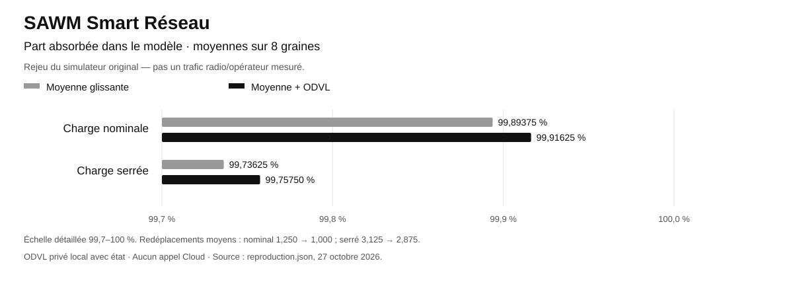

# SAWM Smart Réseau

**Dépôt public SAWM-io.** Aucune clé ni configuration privée n’est incluse. Les identifiants des preuves sont pseudonymisés ; les moteurs restent privés. [Périmètre de publication](PUBLICATION.md).


[Article Medium — Français](docs/articles/SAWM-SMART-RESEAU-MEDIUM.md) · [Medium article — English](docs/articles/SAWM-SMART-RESEAU-MEDIUM-EN.md)

**Mesurez, comparez et adaptez la priorité de vos messages applicatifs.**

[English](README.en.md) · [Guide technique](docs/GUIDE-TECHNIQUE.md) · [Mesures vérifiables](docs/measured-2026-10-27/benchmark.json) · [SAWM Anti-Brouillage](https://github.com/SAWM-io/sawm-anti-brouillage)

Quand les messages arrivent en rafales ou que le service ralentit, l’ordre de traitement compte. **SAWM Smart Réseau** aide les équipes produit et techniques à choisir une politique de file à partir de mesures : latence, respect des échéances, débit et reçus de livraison.

Ce prototype d’évaluation associe une adaptation locale fondée sur les temps HTTP observés à des classements ODVL préparés dans le Cloud. Basira conserve les observations, TSST en vérifie le rappel et SAWM propose une politique bornée. Les décisions par message restent locales.

> **Campagne du 27 octobre 2026 : 1 080 reçus vérifiés, 0 erreur de livraison.** Cinq politiques, trois scénarios synthétiques, trois répétitions et 24 messages par passage, sur un véritable service HTTP local. Des échéances sont manquées ; le détail est conservé dans les résultats.

## Reproduire les résultats du rapport



Le rapport **« Le Réseau qui se souvient »** repose sur un autre banc que les essais HTTP ci-dessous. Son protocole original est maintenant rejoué avec le **moteur ODVL privé réel**, ses empreintes et ses traces. Les moteurs privés ne sont pas distribués dans ce dépôt.

**24 cellules, moyenne glissante de 12 mesures + ODVL, 8 graines × 400 pas** : nominal **99,89 % → 99,92 %**, chargé **99,74 % → 99,76 %** ; redéplacements chargés **3,125 → 2,875**. Le protocole est reproduit ; les mêmes graines ne garantissent pas un bruit identique entre méthodes dans ce simulateur.

[Protocole et chiffres](docs/reference-report-2026-10-27/) · [Visualisation autonome](docs/reference-report-2026-10-27/index.html)

Ce rejeu utilise ODVL avec état local, sans nouvel appel Cloud ni bras TSST. Il ne remplace pas une validation radio physique ou sur réseau opérateur.

## Ce que vous pouvez évaluer

| Votre question | Ce que SAWM Smart Réseau apporte |
| --- | --- |
| Quelle stratégie convient à mes priorités ? | Cinq politiques comparées à arrivées, charges et concurrence identiques. |
| Que se passe-t-il pendant une rafale ? | Trois scénarios déterministes : flux stable, rafales et service lent. |
| Peut-on apprendre des temps de réponse ? | Une estimation EWMA par classe de service, mise à jour à partir des réponses déjà reçues. |
| Peut-on expliquer et rejouer un essai ? | Rapports JSON détaillés, reçus uniques, réponses Cloud et empreintes de provenance. |
| Le Cloud doit-il répondre pour chaque message ? | Aucun appel Cloud pendant la boucle des messages ; les fichiers validés sont chargés avant le passage. |

Le périmètre est une **file de messages applicatifs HTTP**. Le banc utilise uniquement `127.0.0.1` et des données synthétiques ; il ne se branche pas directement sur un service de production. Il ne modifie ni le routage IP ni le matériel réseau. Une intégration métier et sa validation sur des charges représentatives restent à réaliser.

## Une architecture qui sépare préparation et exécution

```mermaid
flowchart LR
    subgraph BEFORE["Avant l'essai · Cloud"]
        A["Calibration locale synthétique"] --> B["Basira · mémoriser"]
        B --> T["TSST · rappeler et vérifier"]
        T --> S["SAWM · proposer un alpha borné"]
        W["Candidats publics sans durées futures"] --> O["ODVL · classer"]
        S --> V["Valider politique et ordres"]
        O --> V
    end
    subgraph LOCAL["Pendant l'essai · local"]
        V --> Q["File · FIFO / échéance / EWMA / ODVL / hybride"]
        Q --> H["Service HTTP local · concurrence 4"]
        H --> R["Reçus et métriques"]
        H --> E["Latences observées · mise à jour EWMA"]
        E --> Q
    end
    subgraph AFTER["Après l'essai · Cloud facultatif"]
        R --> M["Basira · bilan mesuré"]
        M --> U["TSST · rappel vérifié"]
        U --> F["SAWM · analyse du bilan"]
    end
```



**Basira** mémorise les résumés de calibration et de résultats. **TSST** vérifie que le résumé littéral peut être rappelé dans l’espace et l’entité attendus. **ODVL** fournit un classement statique de candidats avant l’essai. **SAWM** propose le coefficient d’apprentissage EWMA, validé entre `0.1` et `0.9`, puis peut commenter les résultats. Ses commentaires restent des avis ; les compteurs du banc font foi.

## Des résultats qui montrent les compromis

Chaque cellule indique **p95 en millisecondes / échéances manquées**. Le p95 est la médiane des trois p95 de passage, de l’arrivée programmée au reçu validé, attente comprise. Les échéances manquées sont totalisées sur les 72 messages de chaque couple politique/scénario.

| Politique | Stable | Rafales | Service lent |
| --- | ---: | ---: | ---: |
| FIFO | 29,1 / 0 | 80,3 / 8 | 333,4 / 48 |
| Échéance d’abord | 29,0 / 0 | 94,4 / 0 | 337,5 / 30 |
| EWMA | 29,8 / 0 | 93,4 / 0 | 329,0 / 32 |
| ODVL | 29,5 / 0 | 69,8 / 15 | 408,2 / 42 |
| EWMA + ODVL | 29,1 / 0 | 95,2 / 6 | 345,2 / 44 |

ODVL obtient le p95 le plus bas sur les rafales, avec davantage d’échéances manquées que FIFO. L’hybride EWMA + ODVL n’est pas systématiquement plus rapide ni plus ponctuel que les références. La valeur du banc est de rendre ces arbitrages visibles avant de choisir une politique.

Sources : [rapport complet](docs/measured-2026-10-27/benchmark.json), [résumé mesuré](docs/measured-2026-10-27/results.json), [appels de préparation](docs/measured-2026-10-27/cloud/cloud-report.json) et [bilan Cloud](docs/measured-2026-10-27/results-cloud/cloud-report.json). Les appels archivés commencent à **15:36:29 UTC** pour la préparation et **15:40:26 UTC** pour le bilan, le 27 octobre 2026. Ces essais courts sur localhost sont sensibles à l’ordonnancement du système ; ils ne constituent ni une garantie de performance ni une validation en production.

## Essayer en local

Prérequis : **Python 3.10+**. Le moteur utilise uniquement la bibliothèque standard. Depuis votre copie autorisée du dépôt :

```bash
git clone https://github.com/SAWM-io/sawm-smart-reseau.git
cd sawm-smart-reseau
python3 -m venv .venv
source .venv/bin/activate
python queue_engine.py --count 24 --repetitions 3 --output output/offline.json
python -m pip install -r requirements.txt
python -m unittest discover -s tests -v
```

Sous Windows PowerShell, activez l’environnement avec `.venv\Scripts\Activate.ps1`. Chaque fichier de sortie doit être neuf.

**Ce premier essai est entièrement hors ligne.** Sans `--orders`, les politiques nommées `odvl` et `ewma_odvl` utilisent l’ordre identité, marqué `offline_identity`. Cela ne constitue pas un véritable classement ODVL et ne démontre aucun effet de cette API.

Pour refaire les mesures locales avec les véritables ordres Cloud **déjà archivés**, sans nouvel appel Cloud :

```bash
python queue_engine.py --count 24 --repetitions 3 \
  --orders docs/measured-2026-10-27/cloud/odvl-orders.json \
  --policy docs/measured-2026-10-27/cloud/policy.json \
  --output output/replay-cloud-orders.json
```

Les timings obtenus varieront d’un passage à l’autre. Les ordres archivés correspondent au jeu fourni de 24 messages ; un autre jeu nécessite ses propres ordres.

## Préparer votre propre campagne Cloud

Dans [Basira](https://basira.sawm.io/espace), sélectionnez votre espace et créez une entité de service pour les essais. Le principal de la clé doit disposer de `read, write` sur cette entité, sans `admin` ni purge, et des scopes **`events:write`, `jobs:read`, `tsst:recall`, `odvl:rank`, `sawm:run`**.

Copiez [.env.example](.env.example) **hors du dépôt**, renseignez `BASIRA_SPACE` et `BASIRA_KEY`, puis appliquez `chmod 600 /chemin/prive/basira.env`. L’endpoint attendu est `https://basira-api.sawm.io/api/v1/basira`. Le connecteur utilise le SDK inclus dans `vendor/` et dépend de `httpx` :

```bash
python -m pip install -r requirements.txt
python queue_engine.py --count 16 --repetitions 1 --output output/calibration.json
python workloads.py --count 24 --output output/workloads-test.json
```

Créez `output/calibration-summary.json` à partir de **votre** calibration avec [l’exemple exécutable du guide](docs/GUIDE-TECHNIQUE.md#produire-les-résumés-de-votre-campagne). Il ne transmet que des agrégats synthétiques. Ensuite, remplacez le chemin privé et l’identifiant d’entité :

```bash
python cloud_control.py prepare --kind network \
  --credentials /chemin/prive/basira.env --entity ent_VOTRE_ENTITE \
  --summary output/calibration-summary.json --workloads output/workloads-test.json \
  --output output/cloud-prepare --run
python queue_engine.py --count 24 --repetitions 3 \
  --orders output/cloud-prepare/odvl-orders.json \
  --policy output/cloud-prepare/policy.json --output output/benchmark.json
```

`--kind network` est le nom historique de ce mode CLI ; son périmètre reste la file applicative. **`--run` active des appels Cloud potentiellement facturés.** Chaque répertoire de sortie Cloud doit être neuf. Les durées futures `service_ms` sont exclues de l’export public et des décisions de priorité. Après l’essai, [le guide](docs/GUIDE-TECHNIQUE.md#produire-les-résumés-de-votre-campagne) explique comment générer et déposer le bilan mesuré avec `cloud_control.py record`.

## Explorer le projet

- [Guide technique](docs/GUIDE-TECHNIQUE.md) : politiques, contrats JSON, limites, provenance et campagne complète.
- [Moteur de file](queue_engine.py), [scénarios](workloads.py), [contrôleur Cloud](cloud_control.py) et [tests](tests/).
- [Dossier de preuves du 27 octobre 2026](docs/measured-2026-10-27/) et [rapport PDF](docs/measured-2026-10-27/report.pdf).
- [SAWM Anti-Brouillage](https://github.com/SAWM-io/sawm-anti-brouillage) : le projet complémentaire consacré à la reprise et à la livraison applicative après des interruptions HTTP.

**Pour un pilote client :** commencez par ce banc reproductible, définissez vos priorités de latence et d’échéance, puis évaluez une intégration sur vos propres scénarios représentatifs.
