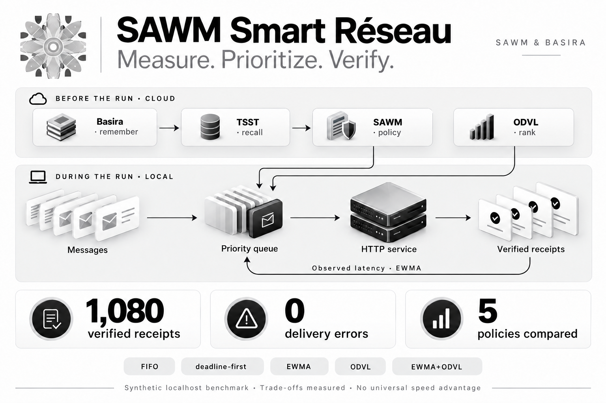

# SAWM Smart Réseau: Put the Right Messages First—with Evidence



*An application queue that compares scheduling decisions, learns from observed response times and records evidence through Basira Cloud.*

A customer confirmation, a shipment update and a background task arrive together. The service cannot process everything immediately. Which message should go first?

That decision affects waiting time, deadlines and service quality. Adding capacity can help, but teams also need to understand what their scheduling policy actually produces.

**SAWM Smart Réseau makes that trade-off measurable.** The prototype connects a local HTTP queue engine to the Basira, TSST, ODVL and SAWM APIs. Its first verifiable result: **1,080 validated receipts and zero delivery errors**, in a synthetic campaign against a real local HTTP service. Some deadlines were missed; those outcomes remain in the results.

## An experiment you can inspect

The October 27, 2026 campaign contains **45 runs**: five policies, three scenarios, three repetitions and 24 messages per run. The scenarios represent steady arrivals, bursts and a slower service.

Each policy receives the same arrivals, workloads and service durations, with no more than four concurrent requests. Only messages that have already arrived are eligible. Future processing durations, known to the fixture server so it can generate the workload, are excluded from scheduling decisions and Cloud inputs.

The [raw campaign report](https://github.com/SAWM-io/sawm-smart-reseau/blob/main/docs/measured-2026-10-27/benchmark.json) retains messages, receipts, errors, measured timings and execution order. These records let readers check the numbers independently of SAWM’s commentary.

## Five ways to choose the next message

The engine compares five policies:

- **FIFO:** process messages in arrival order.
- **Earliest deadline first:** choose the message with the nearest deadline.
- **EWMA:** prioritize the service class with the lowest estimated HTTP time, updating the estimate from completed responses.
- **ODVL:** follow a ranking prepared in the Cloud, among currently available messages.
- **EWMA + ODVL:** combine the local estimate with the Cloud rank.

The hybrid currently assigns a weight of 25 milliseconds to the normalized rank. This is an explicit prototype parameter to evaluate, not an optimum established for every customer. EWMA starts from 40 milliseconds for each run; the benchmark does not demonstrate continuous autonomous learning across campaigns. The [queue engine](https://github.com/SAWM-io/sawm-smart-reseau/blob/main/queue_engine.py) makes these choices inspectable.

## What the four technologies actually do

**Basira records the campaign’s experience.** The connector stores a calibration summary and can subsequently record the measured results.

**TSST verifies recall.** The program searches for the summary and checks that the expected record is recalled literally, within the correct memory space and entity.

**ODVL prepares priorities.** It ranks candidates before a run. In this version, candidate scores come from their deadline budgets, and the returned order must contain exactly the supplied candidates. That order remains fixed during the run.

**SAWM proposes a setting and can review the results.** It supplies the EWMA learning coefficient, accepted only between 0.1 and 0.9. This campaign uses 0.35. No model-generated code is executed.

During the measured runs, **no Cloud call blocks a message**. Scheduling and EWMA adaptation run locally using previously validated files. The archived [Cloud preparation trace](https://github.com/SAWM-io/sawm-smart-reseau/blob/main/docs/measured-2026-10-27/cloud/cloud-report.json) documents the calls that actually took place.

## Why the comparison matters

The burst scenario produced these results:

| Policy | p95, ms | Missed deadlines across 72 messages |
|---|---:|---:|
| FIFO | 80.3 | 8 |
| Earliest deadline first | 94.4 | 0 |
| EWMA | 93.4 | 0 |
| ODVL | 69.8 | 15 |
| EWMA + ODVL | 95.2 | 6 |

Latency includes queueing time, measured from the scheduled arrival to the validated receipt. Each p95 shown here is the median of three run-level p95 values.

ODVL achieves the lowest p95 but misses more deadlines than FIFO. In the slow-service scenario, earliest deadline first misses 30 deadlines, compared with 48 for FIFO and 44 for the hybrid. **The hybrid is therefore not consistently better.** The [complete measurements](https://github.com/SAWM-io/sawm-smart-reseau/blob/main/docs/measured-2026-10-27/benchmark.json) preserve these trade-offs.

Delivery success and deadline success answer different questions. A message may reach its destination correctly and still arrive too late for its intended use. Selecting a policy requires measuring both.

## Where a customer pilot could help

A SaaS provider could evaluate how to protect interactive response deadlines during background processing. A logistics integrator could compare priorities for tracking updates and synchronization events. A document platform could study competition between short requests and longer processing jobs.

These are proposed pilot applications. The repository supplies the benchmark, not already validated business connectors. Its immediate value is a way to choose policies from measurements and an inspectable history. Resource savings and business outcomes still need to be measured against the customer’s workload.

## What could this bring to networks and telecoms?

A pilot could study priorities for industrial-site alerts, monitoring events or deferred synchronization. The current program orders messages for a service; it does not yet select paths through multiple relays.

Going further would require per-link measurements, alternate paths and end-to-end delivery verification. [Multipath TCP](https://www.rfc-editor.org/rfc/rfc8684.html) supports multiple paths between endpoints; [Bundle Protocol](https://www.rfc-editor.org/rfc/rfc9171.html) provides a framework for delay- and disruption-tolerant communication. These are possible integration points, not capabilities already connected here. SAWM and Basira’s contribution would then need measurement: which decisions actually improve recovery, deadline performance or cost?

## Reproduce the experiment, then connect your own space

With Python 3.10 or later and repository access:

```bash
git clone https://github.com/SAWM-io/sawm-smart-reseau.git
cd sawm-smart-reseau
python3 -m venv .venv
source .venv/bin/activate
python -m pip install -r requirements.txt
python -m unittest discover -s tests -v
python queue_engine.py --count 24 --repetitions 3 \
  --orders docs/measured-2026-10-27/cloud/odvl-orders.json \
  --policy docs/measured-2026-10-27/cloud/policy.json \
  --output output/medium-replay.json
```

This run reuses the archived, genuine Cloud orders without making new Cloud calls. Use a new output filename. Timings will vary. Without `--orders`, the ODVL variants use an explicitly marked identity order; that does not test ODVL.

For a fresh campaign, create a test entity in [your Basira space](https://basira.sawm.io/espace). Grant `read, write` on that entity and the scopes `events:write`, `jobs:read`, `tsst:recall`, `odvl:rank`, `sawm:run`. Keep the key outside the repository. The [technical guide](https://github.com/SAWM-io/sawm-smart-reseau/blob/main/docs/GUIDE-TECHNIQUE.md) covers calibration, summary generation, Cloud preparation and result recording. The `--run` option triggers potentially billable Cloud calls.

**The next milestone is a pilot on your representative workload.** Today’s scope remains an HTTP application queue on localhost: no IP routing changes, no radio validation and no universal speed guarantee. It provides a concrete foundation for deciding which priorities actually serve your application.
